<h1 style="text-align: center;" class="ignore-toc"> Numerical Tours of Computational Mechanics with FEniCSx</h1>
<h3 style="text-align: center;" class="ignore-toc"> Jeremy Bleyer</h3>

$\,$

```{image} images/logo.png
:width: 800px
:align: center
```

$\,$

# Welcome


## What is it about?

These numerical tours will introduce you to a wide variety of topics in computational continuum and structural mechanics using the finite element software [`FEniCSx`](https://fenicsproject.org).

````{important}
These tours are compatible with `dolfinx` v0.11. A suitable environment can be installed from `conda-forge` with:

```bash
conda create -n fenicsx-0.11 -c conda-forge \
    fenics-dolfinx=0.11 dolfinx_mpc=0.11 scifem python-gmsh pyvista jax matplotlib
```
````

The book is organized in the following parts:

### Introduction

This part contains a set of short demos to get started with `FEniCSx` via basic examples:

```{grid} 1

  ```{grid-item-card} [**Introductory demos**]{.h3 .pst-color-primary}
  :text-align: center
  :shadow: lg

    ```{grid} 3

      ```{grid-item-card} [**Linear elasticity**]{.pst-color-primary}
      :link: intro/linear_elasticity/linear_elasticity.html

      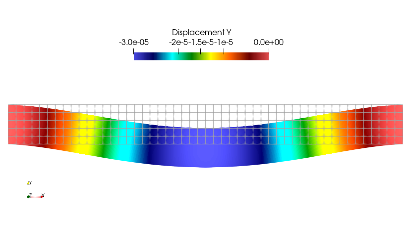
      ```

      ```{grid-item-card} [**Nonlinear elasticity**]{.pst-color-primary}
      :link: intro/hyperelasticity/hyperelasticity.html
      
      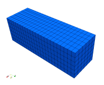
      ```

      ```{grid-item-card} [**Multi-field plate problem**]{.pst-color-primary}
      :link: intro/plates/plates.html
      
      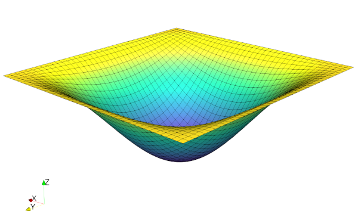
      ```
    ```

  ```

```{seealso}
For another general introduction to `FEniCSx`, we strongly recommend the "official" [FEniCSx tutorial](https://jsdokken.com/dolfinx-tutorial/index.html) by Jørgen S. Dokken.
```

### Tours

This part is the main body of the book. These numerical tours are intended to complement the existing `FEniCSx` tutorials in the official documentation by focusing on specific applications within the field of computational solid and structural mechanics. The purpose of these tours is to offer users with a background in mechanics a starting point for using `FEniCSx`, with examples familiar to them.

Many of the covered topics are standard and relatively easy to implement. Others, such as structural elements (beams, plates and shells), nonlinear constitutive models or interface problems, are more involved, and some reflect current research topics, illustrating the versatility of `FEniCSx` for handling advanced models. The difficulty of each tour is indicated by stars, from {far}`star` (easy) to {far}`star`{far}`star`{far}`star` (difficult).

```{grid} 1

  ```{grid-item-card} [**Numerical tours**]{.h3 .pst-color-primary}
  :text-align: center
  :shadow: lg

    ```{grid} 3

      ```{grid-item-card} [**Linear problems**]{.pst-color-primary}
      :link: tours/linear_problems/contents.html

      
      ```

      ```{grid-item-card} [**Dynamics problems**]{.pst-color-primary}
      :link: tours/dynamics/contents.html
      
      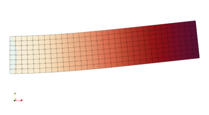
      ```

      ```{grid-item-card} [**Nonlinear problems**]{.pst-color-primary}
      :link: tours/nonlinear_problems/contents.html
      
      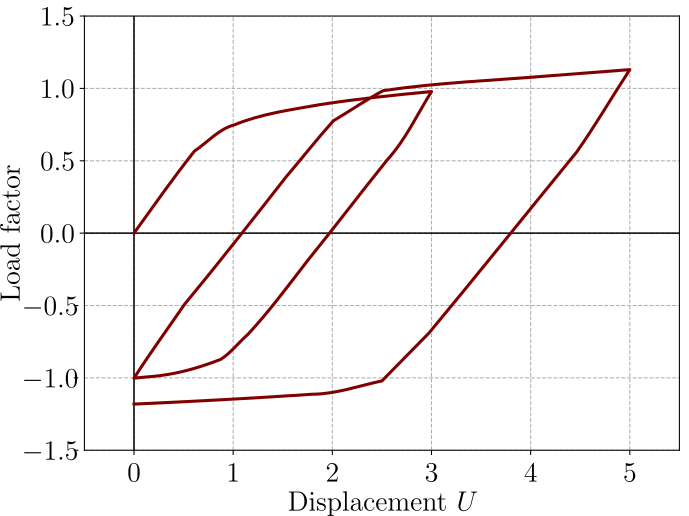
      ```

      ```{grid-item-card} [**Eigenvalue problems**]{.pst-color-primary}
      :link: tours/eigenvalue_problems/contents.html
      
      
      ```

      ```{grid-item-card} [**Homogenization**]{.pst-color-primary}
      :link: tours/homogenization/contents.html
      
      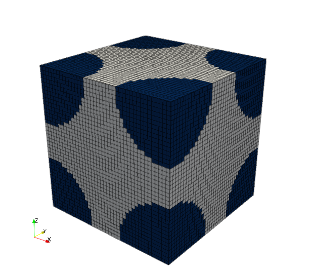
      ```

      ```{grid-item-card} [**Interfaces**]{.pst-color-primary}
      :link: tours/interfaces/contents.html
      
      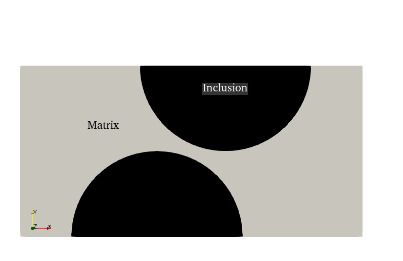
      ```

      ```{grid-item-card} [**Beams**]{.pst-color-primary}
      :link: tours/beams/contents.html
      
      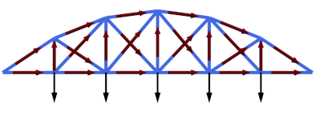
      ```

      ```{grid-item-card} [**Plates**]{.pst-color-primary}
      :link: tours/plates/contents.html
      
      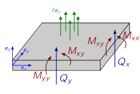
      ```

      ```{grid-item-card} [**Shells**]{.pst-color-primary}
      :link: tours/shells/contents.html

      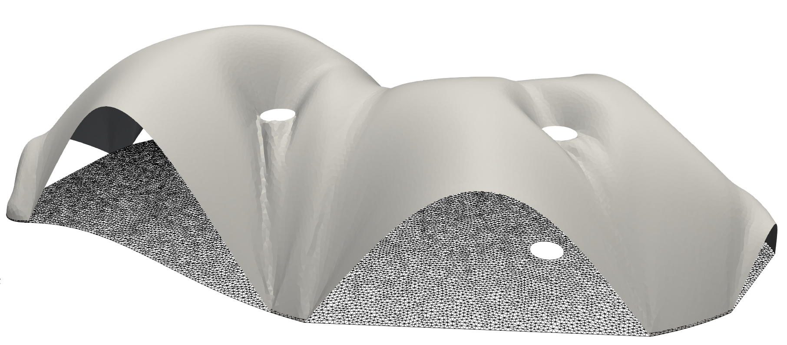
      ```

      ```{grid-item-card} [**Optimization**]{.pst-color-primary}
      :link: tours/optimization/contents.html

      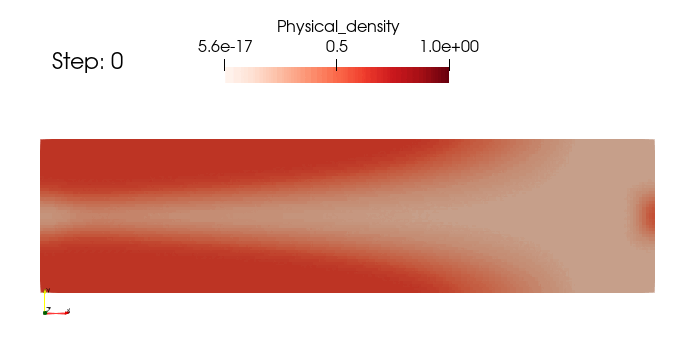
      ```

    ```

  ```

```{seealso}
The previous set of numerical tours based on the legacy `FEniCS` version can be found here https://comet-fenics.readthedocs.io/.
```


### Tips and tricks

This part provides code snippets for various small tasks frequently encountered in computational mechanics with `FEniCSx`.

```{grid} 1

  ```{grid-item-card} [**Tips and tricks**]{.h3 .pst-color-primary}
  :text-align: center
  :shadow: lg

    ```{grid} 3

      ```{grid-item-card} [**Marking facets**]{.pst-color-primary}
      :link: tips/mark_facets/mark_facets.html

      Marking facets with geometrical functions
      ```

      ```{grid-item-card} [**Importing meshes**]{.pst-color-primary}
      :link: tips/import_msh/import_msh.html

      Importing a `.msh` file generated with `Gmsh`
      ```

      ```{grid-item-card} [**Piecewise constant fields**]{.pst-color-primary}
      :link: tips/piecewise_constant_field/piecewise_constant_field.html

      Spatially varying material properties
      ```

      ```{grid-item-card} [**Mass lumping**]{.pst-color-primary}
      :link: tips/mass_lumping/mass_lumping.html

      Lumping a mass matrix
      ```

      ```{grid-item-card} [**Quadrature schemes**]{.pst-color-primary}
      :link: tips/quadrature_schemes/quadrature_schemes.html

      Choosing quadrature rules and degrees
      ```

      ```{grid-item-card} [**Reaction forces**]{.pst-color-primary}
      :link: tips/computing_reactions/computing_reactions.html

      Computing consistent reaction forces
      ```
    ```

  ```


## Citing

If you find these tours useful for your research or teaching, please consider citing them using the following Zenodo DOI. This DOI always points to the latest release; the Zenodo page also gives the DOI of each individual release, should you need to refer to a specific version.

[](https://doi.org/10.5281/zenodo.10470942)

> J. Bleyer, *Numerical tours of Computational Mechanics with FEniCSx*, Zenodo, 2024. https://doi.org/10.5281/zenodo.10470942

```{code-block} bibtex
@software{bleyer2024comet,
  author    = {Bleyer, Jeremy},
  title     = {{Numerical tours of Computational Mechanics with FEniCSx}},
  year      = {2024},
  publisher = {Zenodo},
  doi       = {10.5281/zenodo.10470942},
  url       = {https://doi.org/10.5281/zenodo.10470942}
}
```

Some tours have been written with the help of other contributors, who are acknowledged at the top of the corresponding pages.

```{important}
These tours rely on the `FEniCSx` project. If you use them in published work, please also cite the `FEniCSx` components as [recommended by the FEniCS project](https://fenicsproject.org/citing/), namely:

* I. A. Baratta, J. P. Dean, J. S. Dokken, M. Habera, J. S. Hale, C. N. Richardson, M. E. Rognes, M. W. Scroggs, N. Sime, G. N. Wells. DOLFINx: the next generation FEniCS problem solving environment, preprint, 2023. [doi:10.5281/zenodo.10447666](https://doi.org/10.5281/zenodo.10447666)
* M. W. Scroggs, I. A. Baratta, C. N. Richardson, G. N. Wells. Basix: a runtime finite element basis evaluation library, *Journal of Open Source Software* 7(73), 3982, 2022. [doi:10.21105/joss.03982](https://doi.org/10.21105/joss.03982)
* M. S. Alnæs, A. Logg, K. B. Ølgaard, M. E. Rognes, G. N. Wells. Unified Form Language: a domain-specific language for weak formulations of partial differential equations, *ACM Transactions on Mathematical Software* 40, 2014. [doi:10.1145/2566630](https://doi.org/10.1145/2566630)

as well as the other libraries used in a given tour (e.g. `PETSc`, `Gmsh`, `dolfinx_mpc`, `JAX`) following their own recommendations.
```

All this work is licensed under the [Creative Commons Attribution-ShareAlike 4.0 International License](https://creativecommons.org/licenses/by-sa/4.0/) .


## About the author

[Jeremy Bleyer](https://bleyerj.github.io/) is a researcher in Solid and Structural Mechanics at [Laboratoire Navier](https://navier-lab.fr), a joint research unit (UMR 8205) of [École nationale des ponts et chaussées](https://www.enpc.fr), [Université Gustave Eiffel](https://www.univ-gustave-eiffel.fr/) and [CNRS](https://www.cnrs.fr).

[{fas}`at` jeremy.bleyer@enpc.fr](mailto:jeremy.bleyer@enpc.fr)

[{fab}`linkedin` jeremy-bleyer](https://www.linkedin.com/in/jérémy-bleyer-0aabb531)

[{fab}`orcid` 0000-0001-8212-9921](https://orcid.org/0000-0001-8212-9921)

$\,$

```{image} images/banner_tutelles.png
:class: bg-primary mb-1
:width: 600px
:align: center
```

### Other contributors

```{include} CONTRIBUTORS.md
```